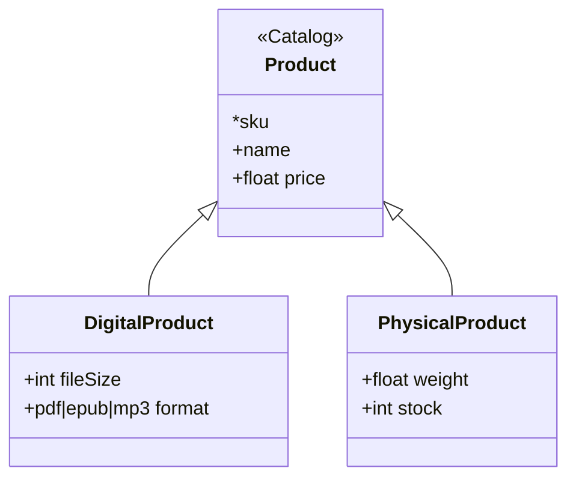

# Examples

Three sketches of the kind a domain conversation produces, each valid as written.

## A booking, first pass

```skiss
# A first pass over booking, written while the domain expert talked.
# Every ? is a question nobody in the room could answer.

Booking @Reservations           # one traveller on one departure
    reference*                  # the code the traveller quotes   ? six characters or eight
    traveller: Traveller
    departure: Departure
    seat                        ? is a seat a string, or a class of its own
    status: held|paid|flown|refunded

Traveller @Reservations         ? is this the same person the loyalty system knows
    id*
    name                        # as it is printed on the ticket
    email

Departure @Timetable            # a flight on a date
    id*
    flightNumber
    departs: datetime
    origin: Airport
    destination: Airport        ? do we need the gate here, or is that operations

Airport @Timetable
    code*
    name
```

## Two systems, one person

```skiss
# The archive and the community wiki both know who a character is.

Character @Catalog              # a person or droid in the archive
    id*
    name
    homeworld: Planet
    films: Film[]

Planet @Catalog
    id*
    name
    climate: arid|temperate|frozen|unknown

Film @Catalog
    id*
    title
    releasedOn: date

CharacterPage @Community ~ Character    # the wiki's version of the same person
    slug*
    characterId = Character.id
    summary                             # free text, written by editors
    editCount: int
```

## Inheritance

```skiss
# A shop where some products are files.

Product @Catalog
    sku*
    name
    price: float

DigitalProduct < Product        # same shape, delivered as a download
    fileSize: int               # bytes
    format: pdf|epub|mp3

PhysicalProduct < Product
    weight: float               # grams
    stock: int
```

Mermaid for the last one, as `skiss diagram` writes it:


