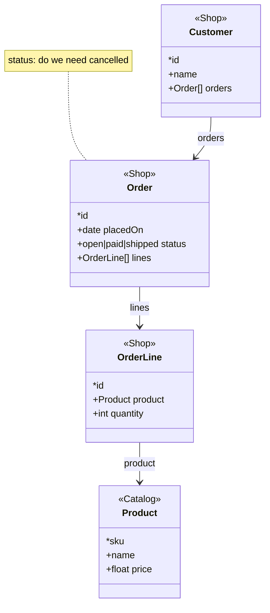

# Skiss to Mermaid

What `skiss diagram` writes, construct by construct. Reproduce it exactly when no shell is available: the diagram must say what the sketch says and nothing more.

The output is a `classDiagram`. Two passes: every class as a box, then every relation.

## Boxes

```
classDiagram
  class Group {
    <<Targeting>>
    *id
    +int priority
    +Audience audience
    +int percent
    +salt
    +Schedule schedule
  }
```

| Sketch | Member line |
|---|---|
| `id*` | `*id` |
| `name` (no type) | `+name` |
| `priority: int` | `+int priority` |
| `audience: Audience` | `+Audience audience` |
| `entries: ScheduleEntry[]` | `+ScheduleEntry[] entries` |
| `targetType: game\|level` | `+game\|level targetType` |
| `Group @Targeting` | `<<Targeting>>` as the first line of the box |

A class that is referenced but never declared gets a box of its own with `<<undeclared>>` and no members.

## Relations

One line per field whose type is a class, after all the boxes:

| Sketch | Relation |
|---|---|
| `audience: Audience` on `Group` | `Group --> Audience : audience` |
| `entries: ScheduleEntry[]` on `Schedule` | `Schedule --> ScheduleEntry : entries` |
| `Child < Parent` | `Parent <\|-- Child` |
| `CharacterPage ~ Character` | `CharacterPage ..> Character : similar` |
| `characterId = Character.id` on `CharacterPage` | `CharacterPage ..> Character : characterId = id` |

A `[]` relation draws the same as a single one. The plural is visible on the member line (`ScheduleEntry[]`); the arrow carries no multiplicity, because the sketch said "many" and nothing about the other end.

Inheritance is drawn parent first and unlabelled, and the parent's fields are not repeated in the child's box.

## Notes

With `--notes`, every `?` doubt becomes a note on its class:

```
  note for ScheduleEntry "from: whose day governs, UTC or player-local"
```

A class-line doubt is `note for Class "text"`; a field doubt is prefixed with the field name and a colon. Without `--notes` the doubts are left out of the diagram and listed by the tools instead.

## Complete example

Sketch:

```skiss
Customer @Shop
    id*
    name
    orders: Order[]

Order @Shop
    id*
    placedOn: date
    status: open|paid|shipped       ? do we need cancelled
    lines: OrderLine[]

OrderLine @Shop
    id*
    product: Product
    quantity: int

Product @Catalog
    sku*
    name
    price: float
```

Diagram, as `skiss diagram --notes` writes it:


